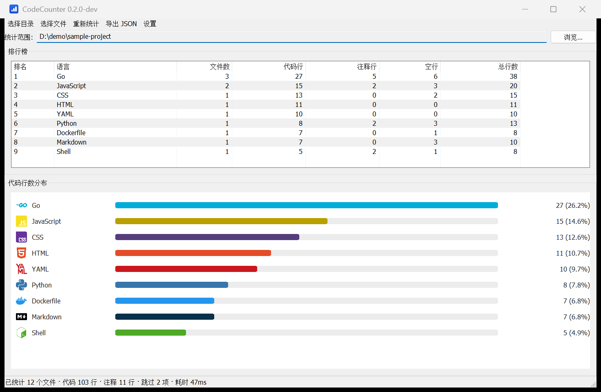

# CodeCounter

[](https://github.com/linfunss/codecounter/actions/workflows/ci.yml)
[](https://github.com/linfunss/codecounter/actions/workflows/release.yml)
[](LICENSE)

一个 Windows 原生的代码行数统计小工具：扫描指定目录或文件，自动跳过
`node_modules`、`.idea` 等冗余内容，并以「排行榜 + 条形图 + 语言图标」
直观展示各语言的代码量。



> 界面使用 Win32 原生控件（`lxn/walk`），不依赖 WebView，跟随系统主题，支持高 DPI。

## 功能

- 统计目录或指定文件的代码行数，**代码 / 注释 / 空行分别计数**
- 默认统计**启动时的工作目录**，可随时切换
- 内置冗余目录与文件排除规则，并支持自定义 glob 规则与 `!` 取反
- 可选择读取统计目录下的 `.gitignore`
- 排行榜 + 横向条形图，按代码行数降序展示，并显示真实语言 logo
- 统计结果可导出为 JSON
- 无控制台窗口，应用图标已嵌入，支持高 DPI，无需任何运行时依赖
- 附带命令行模式，便于在脚本或 CI 中使用

## 设置

工具栏「设置」按钮打开设置对话框，包含四个标签页：

| 标签页 | 内容 |
| --- | --- |
| 通用 | 默认统计目录策略（启动时工作目录 / 上一次使用 / 固定目录） |
| 排除规则 | 内置排除名单开关、`.gitignore` 开关、自定义规则编辑 |
| 显示 | 语言图标开关、条形图显示数量上限 |
| 关于 | 版本、项目地址与许可证 |

配置保存在 `%APPDATA%\CodeCounter\config.json`，可在对话框底部打开所在
文件夹，或一键恢复默认设置。

## 开发状态

项目处于早期开发阶段。

| 阶段 | 内容 | 状态 |
| --- | --- | --- |
| P0 | 工程骨架与仓库初始化 | ✅ 已完成 |
| P1 | 计数引擎与排除规则 | ✅ 已完成 |
| P2 | 原生主界面与条形图 | ✅ 已完成 |
| P3 | 设置对话框与目录选择 | ✅ 已完成 |
| P4 | 资源文件与高 DPI | ✅ 已完成 |
| P5 | CI/CD 与自动发布 | ✅ 已完成 |
| P6 | 文档与验收 | 🚧 进行中 |

## 环境要求

- 运行：Windows 10 / 11，无需任何运行时依赖
- 构建：Go 1.25.2 或更高版本

## 构建

```powershell
git clone https://github.com/linfunss/codecounter.git
cd codecounter

# 常规构建（保留控制台，便于查看日志）
go build -o codecounter.exe ./cmd/codecounter

# 发布构建（隐藏控制台窗口）
go build -ldflags "-H=windowsgui" -o codecounter.exe ./cmd/codecounter
```

`cmd/codecounter` 下的 `.syso` 是 Windows 资源文件，用于嵌入应用清单
（通用控件 6.0 与高 DPI 感知）。它由图 `winres/app.manifest` 生成并
纳入版本管理，修改清单后执行 `go generate ./cmd/codecounter` 重新生成。

`internal/ui/assets/icons` 下的语言图标已随仓库提交，通常不需要重新生成。
如需更新，执行 `make icons`（需要联网），图标来源与许可见 [NOTICE](NOTICE)。

## 命令行用法

```powershell
# 统计当前目录
codecounter --cli

# 统计指定目录
codecounter --cli --path D:\projects\demo

# 统计指定文件（多个文件以分号分隔）
codecounter --cli --file "main.go;app.py"

# 输出 JSON
codecounter --json --path .

# 附加排除规则
codecounter --cli --path . --ignore "*.min.js;docs/"

# 查看帮助与版本
codecounter --help
codecounter --version
```

不带 `--cli` / `--json` 参数时默认启动图形界面。

> 命令行模式下的排除规则参数只作用于该次运行；图形界面使用配置文件中的设置。
> 图形界面下仍可用 `--path` 指定启动时统计的目录。

## 默认排除的内容

内置名单覆盖常见的依赖、缓存、构建产物与编辑器目录，例如
`node_modules`、`.idea`、`.vscode`、`vendor`、`dist`、`build`、`target`、
`__pycache__`、`.venv`、`bin`、`obj`、`coverage`、`tmp` 等。

同时会跳过 `.gitignore`、`.editorconfig` 这类配置文件和 `go.sum`、
`package-lock.json` 等自动生成的锁定文件。

可在界面或命令行中追加自定义规则，规则支持 glob 通配与 `!` 取反。

## 文档

- [开发计划](docs/开发计划.md)
- [发布流程](docs/发布流程.md)
- [贡献指南](CONTRIBUTING.md)
- [变更记录](CHANGELOG.md)
- [安全策略](SECURITY.md)
- [第三方资源说明](NOTICE)

## 许可证

[MIT](LICENSE)
